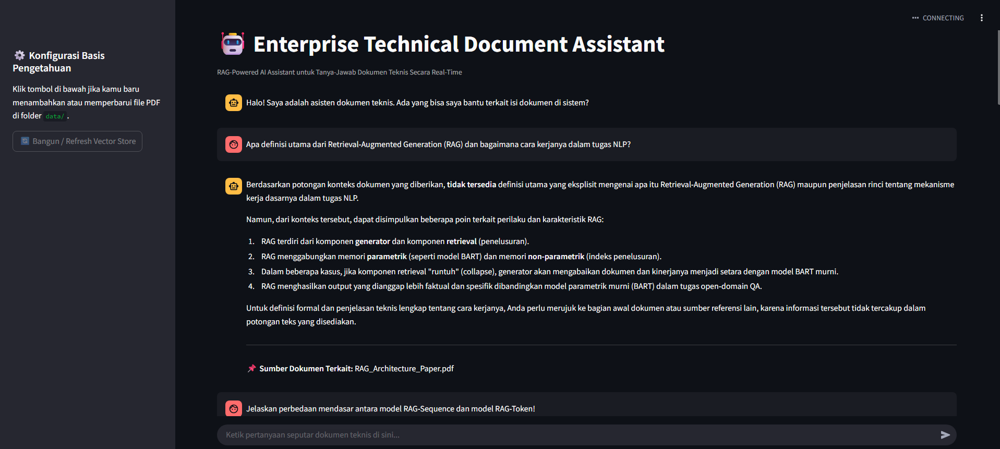
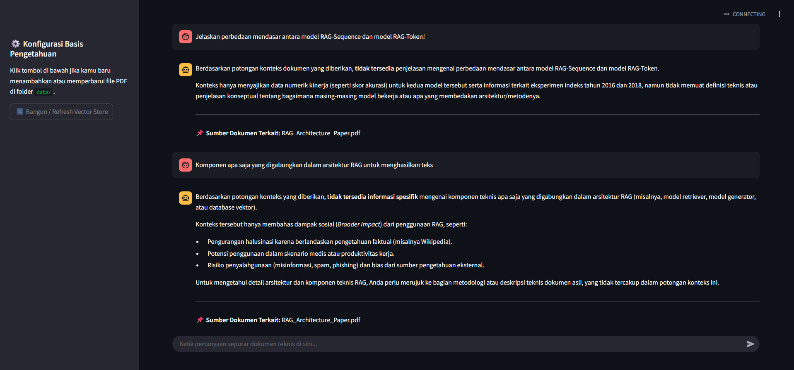

# 🤖 Enterprise Technical Document Assistant (RAG System)

A production-grade Retrieval-Augmented Generation (RAG) system built to ingest enterprise PDF documents, perform semantic chunking, store vector embeddings locally using ChromaDB, and deliver real-time, grounded answers using state-of-the-art LLMs via Groq Cloud.

## 🛠️ Tech Stack
- **Orchestration:** LangChain (`langchain-community`, `langchain-chroma`, `langchain-groq`)
- **Vector Database:** ChromaDB
- **Embeddings:** HuggingFace Sentence-Transformers (`all-MiniLM-L6-v2`)
- **LLM Inference:** Groq Cloud (`Llama-3` / Versatile models)
- **Frontend UI:** Streamlit

## 📂 Project Structure
```text
    Enterprise-Technical-Document-Assistant/
    ├── data/                  # Folder for input PDF documents
    ├── vectorstore/           # Local ChromaDB vector storage (ignored in git)
    ├── src/
    │   ├── rag_engine.py      # Core RAG pipeline, chunking, and embedding logic
    │   └── app.py             # Interactive Streamlit chat interface
    ├── .env                   # Environment variables for API keys (ignored in git)
    ├── .gitignore             # Git exclusion rules
    └── requirements.txt       # Project dependencies
```

🚀 How to Run Locally
    
1. Clone this repository:
    git clone [https://github.com/Yazzar21/Enterprise-Technical-Document-Assistant-RAG.git](https://github.com/Yazzar21/Enterprise-Technical-Document-Assistant-RAG.git)
    cd Enterprise-Technical-Document-Assistant-RAG
    
2. Set up a virtual environment & install dependencies:
    python -m venv venv
    # Windows:
    .\venv\Scripts\activate
    # Mac/Linux:
    # source venv/bin/activate
    
    pip install -r requirements.txt
    
3. Configure your environment variables:
    Create a .env file in the root directory and add your Groq API key:
    GROQ_API_KEY=your_actual_groq_api_key_here
    
4. Run the RAG indexing engine:
    Place your PDF files inside the data/ folder, then run:
    python src/rag_engine.py

---

## 📊 System Demo & Evaluation

Here is a preview of the RAG system successfully answering technical queries grounded in the ingested research paper:

### 1. Technical Component Retrieval (DPR & Encoder Configuration)


### 2. Performance Comparison (RAG vs. Parametric Models)



Final Way => Launch the Streamlit Web Application:
streamlit run src/app.py

💡 Features
- Automatic Model Resolution: Dynamically fetches active LLM endpoints from Groq to ensure uninterrupted API compatibility.
- Grounded Generation: Strict prompt engineering ensures answers are derived exclusively from document context to prevent hallucinations.
